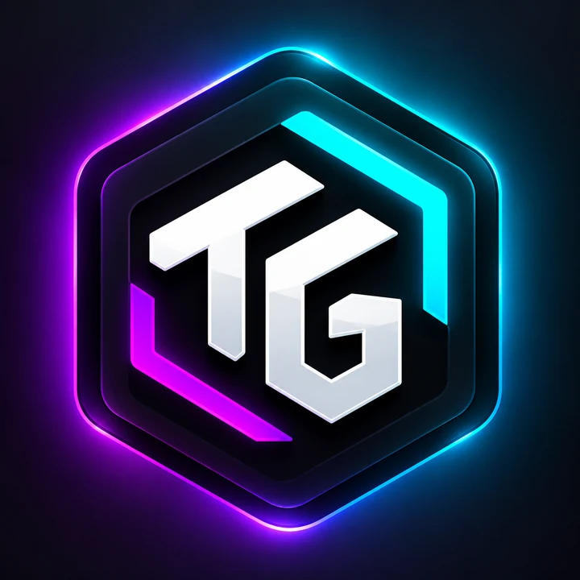
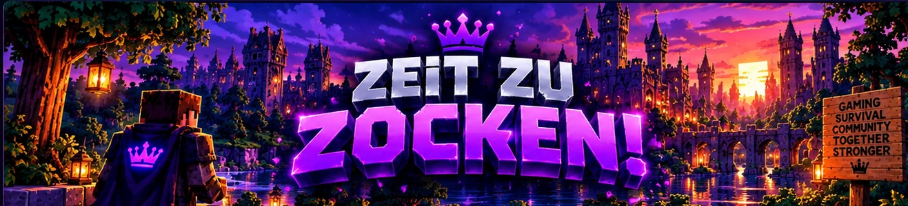

# Tegnas Launcher & Client

**Dein Spiel. Dein Tegnas.**

Profile, Mods und Ressourcen an einem Ort – mit einem eigenen Client für deinen Spielstil.

[Website](https://tegnas.github.io/tegnas-launcher/) · [Download & Releases](https://github.com/Tegnas/tegnas-launcher/releases) · [Discord](https://discord.gg/2txGwR6A4v)

## Dein Launcher

- **Profile & Konten:** Eigene Instanzen, Profilbilder und Kontozuordnung.
- **Duplizieren:** Auswählen, welche Mods, Ressourcenpakete und Shader mitkommen und welchem Konto das Profil zugeordnet wird.
- **Mods:** Über Modrinth verwalten und verfügbare Updates erkennen.
- **Dein Look:** Ressourcenpakete, Shader und Skins passend zum Profil verwalten.
- **Updates:** Hinweise auf neue Versionen und Änderungen direkt im Launcher.
- **Vote Reminder:** Die Vote-Seiten deines Servers und den nächsten Vote im Blick behalten.

## Dein Tegnas Client

Der Client ist im Launcher enthalten und wird passend zur Minecraft-Version eingerichtet.

- Anpassbare HUD-Anzeigen, darunter Koordinaten, FPS und Weltzeit.
- Integrierter MSG Chat für private Nachrichten.
- Eigene Tegnas Einstellungen mit dunklem Modus und Akzentfarben.
- Shulkervorschau als Raster direkt im Inventar.
- Account-Wechsler im Spielmenü.

## Freigegebene Minecraft-Versionen

| Minecraft | Tegnas Client mit Fabric | Vanilla |
| --- | --- | --- |
| 1.21.8 | ✓ | ✓ |
| 1.21.10 | ✓ | ✓ |
| 1.21.11 | ✓ | ✓ |
| 26.3 | ✓ | ✓ |

Die Tegnas-Modfunktionen benötigen **Fabric**. Bei **Vanilla** wird Minecraft ohne diese Client-Funktionen gestartet. Zusätzliche Mods, Shader und Ressourcenpakete müssen zu deinem jeweiligen Profil passen.

## Loslegen

1. Die **TegnasLauncher.exe** aus den [GitHub-Releases](https://github.com/Tegnas/tegnas-launcher/releases) herunterladen und installieren.
2. Mit deinem Microsoft-Konto anmelden.
3. Ein Profil erstellen, Minecraft-Version und Loader auswählen.
4. Dein Setup ergänzen und **Spielen** drücken.

**Für Windows 10 und 11, 64 Bit.** Zum regulären Spielen wird ein Konto mit Minecraft: Java Edition benötigt. Die Anmeldung erfolgt über den offiziellen Microsoft-Login.

## Hilfe & Feedback

Fragen, Ideen oder einen Fehler gefunden? Melde dich auf unserem [Discord-Server](https://discord.gg/2txGwR6A4v). Bei Fehlern helfen die Launcher-Version, Minecraft-Version und die passende Logdatei. Zugangsdaten und Sitzungstoken vor dem Teilen entfernen.

Die Änderungen jeder veröffentlichten Version stehen in den [Release-Notes](https://github.com/Tegnas/tegnas-launcher/releases).

## Über dieses Repository

Dieses Repository enthält die öffentliche Tegnas-Website und die veröffentlichten Releases.

Beim Aktualisieren der Website den **`update`-Ordner beibehalten**. Die HTML-Datei, zugehörige Design- und Skriptdateien sowie der Asset-Ordner gehören jeweils zusammen.

---

Tegnas ist ein unabhängiges Projekt und kein offizielles Minecraft-Produkt. Es ist nicht mit Mojang oder Microsoft verbunden.
