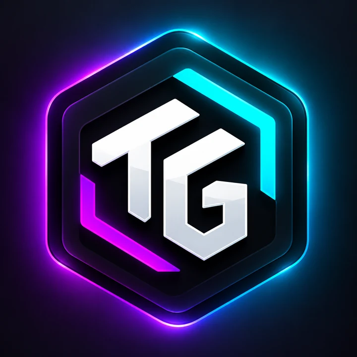
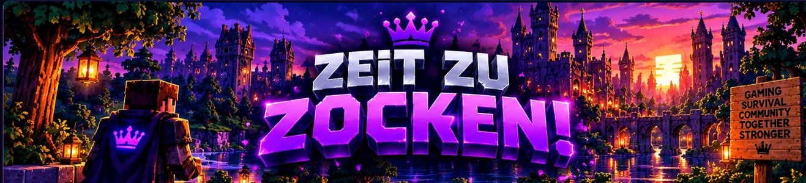

# Tegnas Launcher & Client

**Dein Spiel. Dein Tegnas.**

Deine Profile, Mods und Packs an einem Ort. Dein eigener Client im Spiel. Dein Setup auch auf dem Laptop.

**Kostenlos für Windows 10 und 11 · 64 Bit**

[Website](https://tegnaslauncher.de/) · [Download & Releases](https://github.com/Tegnas/tegnas-launcher/releases) · [Verbesserung vorschlagen](https://github.com/Tegnas/tegnas-launcher/issues/new?title=Verbesserungsvorschlag) · [Discord](https://discord.gg/2txGwR6A4v)

## Dein Setup – auf PC und Laptop

Mit den **Cloud-Profilen über dein eigenes OneDrive** kannst du ausgewählte Profildaten zwischen deinen Geräten abgleichen. Minecraft verwendet weiterhin die **lokalen Profilordner**.

- Mods, Ressourcenpakete, Shader und Einstellungen synchronisieren.
- Schematics, Karten und Wegpunkte, Welten, Voxy-Daten, Screenshots und das MSG-Chatarchiv bei Bedarf einbeziehen.
- Nach der ersten Übertragung nur neue oder geänderte Dateien übertragen; kleine Dateien werden gebündelt.
- Automatischen Abgleich im Hintergrund nutzen, solange der Launcher geöffnet ist. Vollständige Profilabgleiche erfolgen bei geschlossenem Spiel.
- Bei Konflikten selbst entscheiden, welchen Stand du behalten möchtest. Löschungen werden im manuellen Abgleich bestätigt; vor dem Verwerfen lokaler Änderungen wird eine lokale Sicherung angelegt.
- Zusätzlich ein vollständiges Cloud-Backup des Launchers erstellen und wiederherstellen.

Minecraft-Anmeldungen, RAM-Zuweisung, Java-Pfade und Bildschirm-Einstellungen bleiben auf dem jeweiligen Gerät. Für den Gerätewechsel auf beiden Rechnern dasselbe OneDrive-Konto verbinden und das gewünschte Cloud-Profil herunterladen bzw. verknüpfen.

**Cloud-Synchronisierung ist noch in der Beta.** Große Datenmengen brauchen beim ersten Übertragen Zeit. Beim Schließen läuft der Abgleich nur begrenzt weiter; offene Änderungen bleiben für den nächsten Start erhalten. Prüfe vor dem Gerätewechsel, ob die Synchronisierung abgeschlossen ist.

## Dein Launcher

| Funktion | Was du damit machen kannst |
| --- | --- |
| **Profile & Konten** | Eigene Instanzen erstellen, Konten zuordnen und Profile mit Bildern und Hintergründen gestalten. |
| **Duplizieren** | Konto und Inhalte auswählen, die ins neue Profil mitkommen – einschließlich unterstützter Mod-Daten wie Schematics oder Voxy. |
| **Mods & Modpacks** | Inhalte über Modrinth finden und verwalten; verfügbare Mod-Updates erkennen. |
| **Ressourcenpakete, Shader & Skins** | Deinen Look passend zum Profil zusammenstellen. |
| **Updates** | Neue Launcher-Versionen installieren und im Bereich „Was ist neu“ durch die Änderungen blättern. |
| **Tegnas-Meldungen** | Im Ticker und auf der Meldungsseite sehen, woran gearbeitet wird und welche Probleme bekannt sind. |
| **Verbesserungsvorschläge** | Ideen im Launcher formulieren und als vorbereiteten GitHub-Issue selbst absenden. Dafür wird ein GitHub-Konto benötigt. |
| **Integrierte Konsole** | Startmeldungen, Warnungen und Fehler direkt im Launcher ansehen und Logs zur Fehlersuche nutzen. |
| **Vote Reminder** | Die Vote-Seiten deines Servers und den nächsten Vote im Blick behalten. |

## Dein Tegnas Client

Der Client ist im Launcher enthalten und wird passend zur unterstützten Minecraft-Version eingerichtet.

- **Tegnas-Menü:** Eigene Einstellungen, dunkler Modus und anpassbare Akzentfarben.
- **HUD:** Anpassbare Anzeigen, unter anderem für Koordinaten, FPS und Weltzeit.
- **MSG-Chat:** Private Unterhaltungen mit Uhrzeiten, wechselbaren Chat-Reitern und einem großen Chatarchiv für die letzten **30 Tage**. Das Schließen eines kleinen Chat-Reiters löscht den Archivverlauf nicht.
- **Freunde-Status:** Unterstützte Online-/Offline-Meldungen im MSG-Chat anzeigen und einen Spieler zum Anschreiben anklicken. Die Erkennung hängt von den Informationen ab, die der Server liefert.
- **Offline-Schreibhilfe:** Vorschläge oder automatische Korrektur im privaten MSG-Eingabefeld – direkt eingebaut, ohne Zusatzinstallation oder externen Korrekturdienst. Auch abschaltbar.
- **Shulkervorschau:** Den Inhalt einer Shulkerbox als Raster ansehen.
- **Account-Wechsler:** Zwischen gespeicherten Konten im Spielmenü wechseln.

## Unterstützte Minecraft-Versionen

| Minecraft | Tegnas Client mit Fabric | Vanilla |
| --- | --- | --- |
| 1.21.8 | ✓ | ✓ |
| 1.21.10 | ✓ | ✓ |
| 1.21.11 | ✓ | ✓ |
| 26.3 | ✓ | ✓ |

Die Tegnas-Modfunktionen benötigen **Fabric**. Mit **Vanilla** startest du Minecraft ohne diese Client-Funktionen. Zusätzliche Mods, Shader und Ressourcenpakete müssen zur jeweiligen Minecraft-Version passen.

## Loslegen

1. Die **TegnasLauncher.exe** aus den [GitHub-Releases](https://github.com/Tegnas/tegnas-launcher/releases) herunterladen und installieren. Beta-Versionen sind dort entsprechend gekennzeichnet.
2. Über den offiziellen Microsoft-Login mit deinem Minecraft-Konto anmelden.
3. Ein Profil benennen, eine unterstützte Minecraft-Version und den Loader auswählen. Der Profilordner wird automatisch angelegt.
4. Mods, Packs oder Shader ergänzen und **Spielen** drücken.
5. Optional unter **System → Cloud-Synchronisierung** OneDrive verbinden und auswählen, welche Profildaten abgeglichen werden sollen.

Zum regulären Spielen benötigst du ein Konto mit **Minecraft: Java Edition**. Inno Setup und andere Build-Werkzeuge sind für die Installation durch Spieler nicht erforderlich.

## Hilfe & Feedback

Fragen oder Hilfe beim Einrichten? Komm auf unseren [Discord-Server](https://discord.gg/2txGwR6A4v).

Fehler und Ideen kannst du auch unter [GitHub Issues](https://github.com/Tegnas/tegnas-launcher/issues) melden. Hilfreich sind Launcher- und Minecraft-Version, die Schritte bis zum Fehler und die passende Logdatei. Prüfe Logs vor dem öffentlichen Teilen auf persönliche Daten und Zugangsdaten. Bei Cloud-Problemen kannst du im Cloud-Bereich einen Messbericht speichern.

Alle veröffentlichten Änderungen findest du in den [Release-Notes](https://github.com/Tegnas/tegnas-launcher/releases). Aktuelle Meldungen aus der Entwicklung stehen auch auf der [Website](https://tegnaslauncher.de/#aktuelles).

## Über dieses Repository

Hier liegen die öffentliche Tegnas-Website, die Update-Informationen, die Tegnas-Meldungen und die veröffentlichten Releases. Die neueste veröffentlichte Versionsnummer und die zugehörigen Downloads findest du unter [Releases](https://github.com/Tegnas/tegnas-launcher/releases).

Das Projekt wird mit KI-Unterstützung entwickelt.

---

Tegnas ist ein unabhängiges Projekt und kein offizielles Minecraft-Produkt. Es ist nicht mit Mojang oder Microsoft verbunden.
